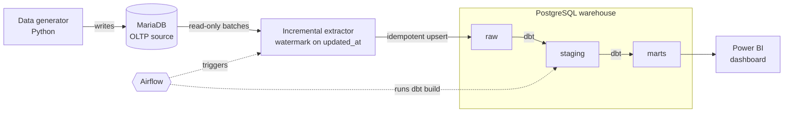
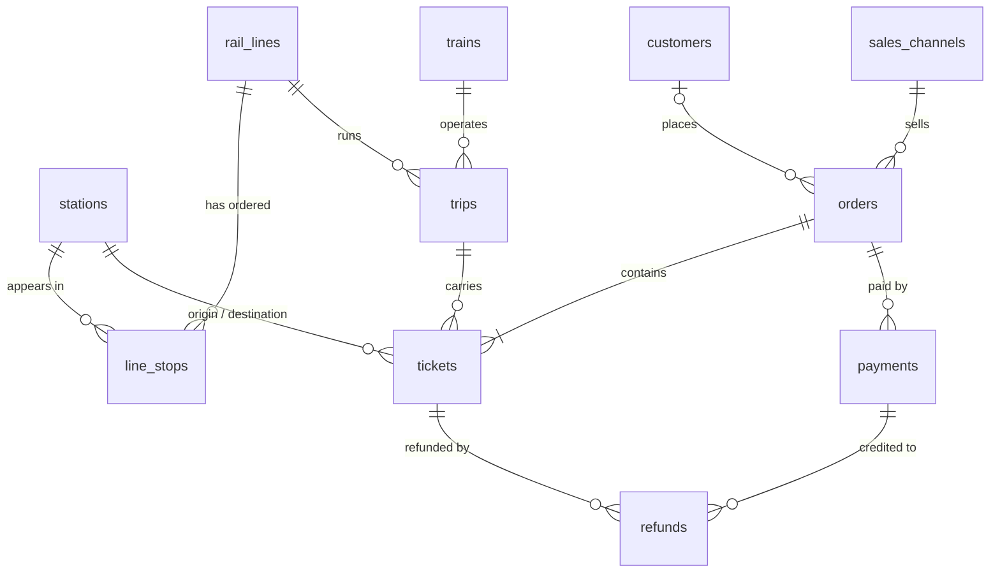

# Rail Ticketing Data Platform

[](https://github.com/bugtronik/rail-ticketing-data-platform/actions/workflows/ci.yml)

End-to-end ELT pipeline for a **fictional** rail operator's ticket sales:
a production-like MariaDB database feeds a PostgreSQL warehouse, modelled with
dbt and orchestrated by Airflow, so that a sales team can track revenue,
load factor, cancellations and sales channels **without querying production**.

All data is synthetic, produced by the project's own generator.

> 🚧 **Work in progress** — current milestone: **J1, MariaDB source schema**.

## Target architecture



## Stack

| Tool | Why it is here |
|---|---|
| MariaDB | Simulates the production OLTP database |
| PostgreSQL | Analytical warehouse, layered `raw` → `staging` → `marts` |
| Python | Data generator and incremental extractor |
| dbt Core | SQL transformations, dimensional model, data tests, docs |
| Airflow | Scheduling, retries, idempotent re-runs |
| Docker Compose | One-command reproducible environment |
| GitHub Actions | Lint and tests on every push |
| Power BI | Business dashboard on the `marts` layer |

## Roadmap

- [x] **J0** — Repository foundations, tooling, CI lint
- [x] **J1** — MariaDB source schema
- [ ] **J2** — Synthetic data generator
- [ ] **J3** — Incremental extraction to PostgreSQL
- [ ] **J4** — dbt dimensional model and tests
- [ ] **J5** — Airflow orchestration, full `docker compose up` (MVP)
- [ ] **J6** — End-to-end CI, published dbt docs
- [ ] **J7** — Incremental dbt models, customer history (SCD2)
- [ ] **J8** — Power BI dashboard
- [ ] **J9** — Benchmarks, final documentation

## Design decisions

Each significant choice is recorded as an Architecture Decision Record:

- [ADR 0001 — Batch incremental ingestion first, CDC later](docs/adr/0001-batch-incremental-ingestion.md)
- [ADR 0002 — Python tooling: uv, Ruff, SQLFluff, pre-commit](docs/adr/0002-python-tooling.md)
- [ADR 0003 — Source schema designed for incremental extraction](docs/adr/0003-source-schema-design.md)

## Getting started

Requirements: Docker (Desktop with WSL2 on Windows), [uv](https://docs.astral.sh/uv/), `make`.

```bash
cp .env.example .env   # then change the passwords
make install           # virtualenv from uv.lock + git hooks
make up                # start the stack, wait until healthy
make test              # run the test suite against it
```

Other commands: `make help`. `make reset` deletes the data volumes, so the
database is rebuilt from `source/mariadb/init/` on the next `make up`.

## Source data model

Simulated production database (MariaDB, normalised). Every table also has
`created_at` / `updated_at`, maintained by the database.



## License

[MIT](LICENSE)
