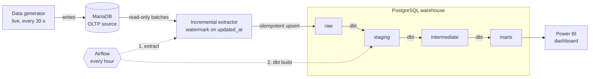
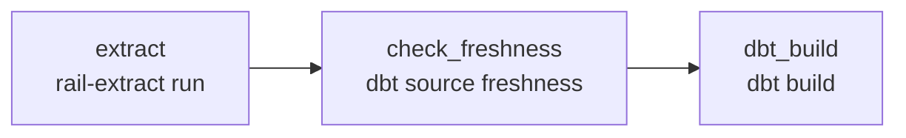
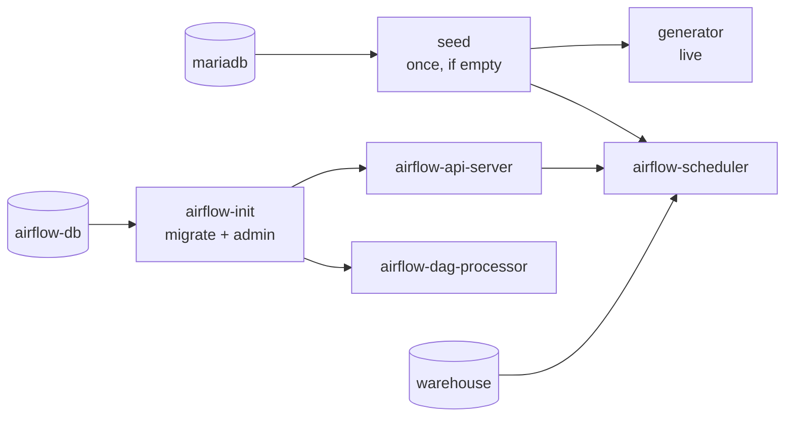
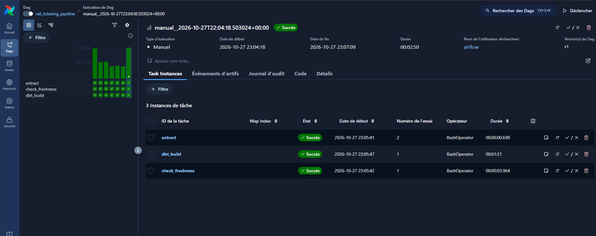
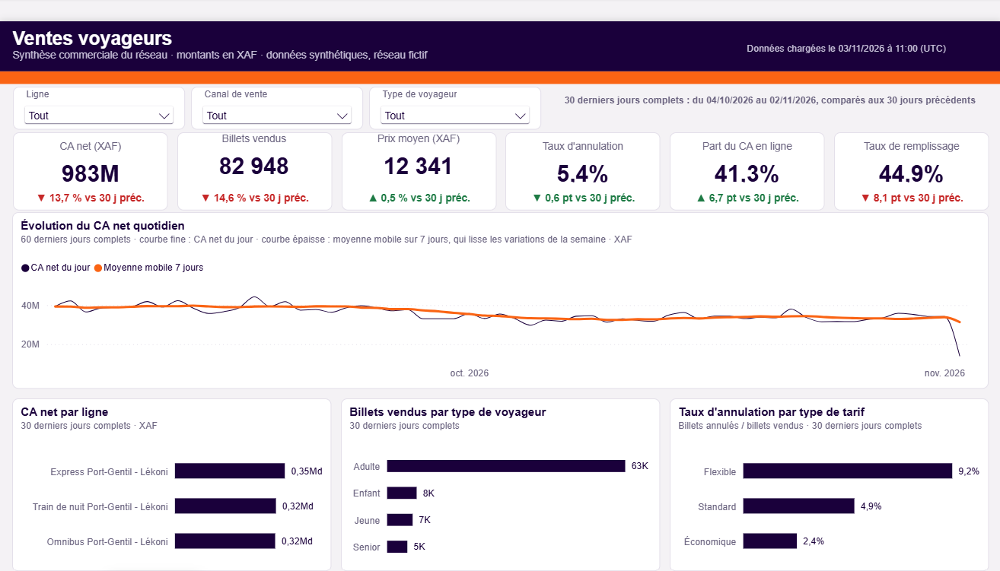
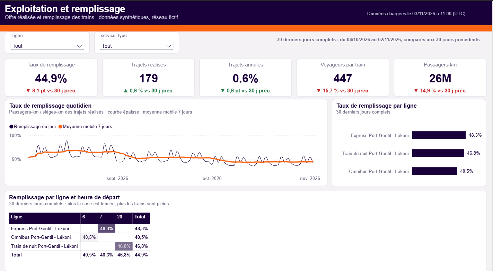
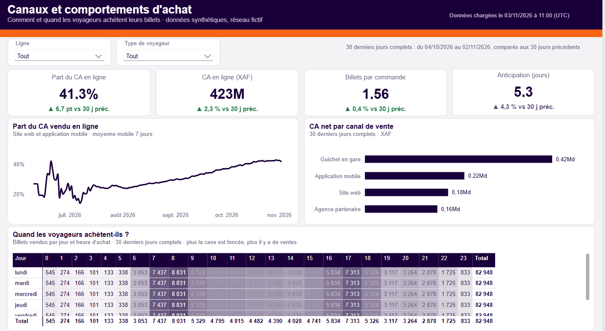
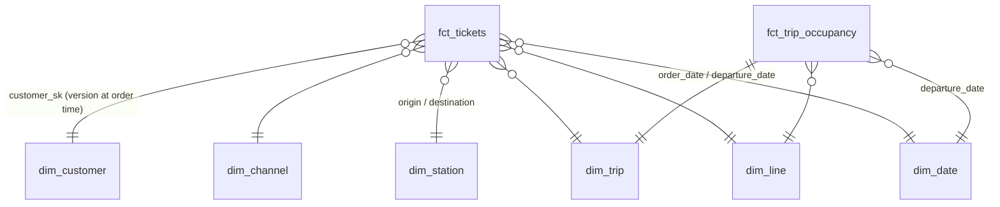
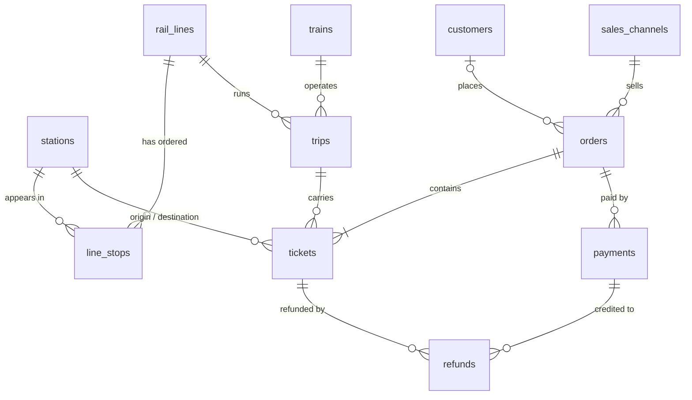

# Rail Ticketing Data Platform

[](https://github.com/bugtronik/rail-ticketing-data-platform/actions/workflows/ci.yml)

End-to-end ELT pipeline for a **fictional** rail operator's ticket sales:
a production-like MariaDB database feeds a PostgreSQL warehouse, modelled with
dbt and orchestrated by Airflow, so that a sales team can track revenue,
load factor, cancellations and sales channels **without querying production**.

All data is synthetic, produced by the project's own generator.

**📚 [dbt documentation and lineage](https://bugtronik.github.io/rail-ticketing-data-platform/)**:
every model, column and test, rebuilt by the CI on each push to `main`.

## Key results

Measured on a WSL2 laptop (16 GB RAM), with 90 days of history plus live
activity, unless stated otherwise.

| | |
|---|---|
| **One command** | `make env && make up` starts the 9 services: ~11 min the first time (image build), 2 to 4 min after |
| **Hourly pipeline** (16 runs) | median **75 s**, 95th percentile **187 s**: extract 11 s, freshness check 10 s, `dbt build` 41 s (medians) |
| **Data quality** | 143 dbt nodes pass on every run (119 data tests, 1 unit test), in 44 s on 346,000 tickets; 87 Python tests; the whole platform rebuilt and checked by the CI on every push |
| **Extraction at scale** (2 years of history) | 6.03 M rows loaded in 167 s; an hourly increment of 845 rows in 0.3 s |
| **Dashboard** | 3 Power BI pages; the 9 control figures identical in DAX and in SQL, to the franc; refresh in 43 s |
| **Reliability** | 1 failed run out of 16, during the shared-memory incident below, none since the fix; every task idempotent, `extract` survives a stopped database |

## Architecture



## Stack

| Tool | Why it is here |
|---|---|
| MariaDB | Simulates the production OLTP database |
| PostgreSQL | Analytical warehouse, layered `raw` → `staging` → `intermediate` → `marts` |
| Python | Data generator and incremental extractor |
| dbt Core | SQL transformations, dimensional model, data tests, docs |
| Airflow | Scheduling, retries, idempotent re-runs |
| Docker Compose | One-command reproducible environment |
| GitHub Actions | Lint, tests, the whole platform run end to end, dbt docs published on Pages |
| Power BI | Business dashboard on the `marts` layer |

## Roadmap

- [x] **J0** — Repository foundations, tooling, CI lint
- [x] **J1** — MariaDB source schema
- [x] **J2** — Synthetic data generator
- [x] **J3** — Incremental extraction to PostgreSQL
- [x] **J4** — dbt dimensional model and tests
- [x] **J5** — Airflow orchestration, full `docker compose up` (MVP)
- [x] **J6** — End-to-end CI, published dbt docs
- [x] **J7** — Incremental dbt models, customer history (SCD2)
- [x] **J8** — Power BI dashboard
- [x] **J9** — Benchmarks, final documentation

## Design decisions

Each significant choice is recorded as an Architecture Decision Record:

- [ADR 0001 — Batch incremental ingestion first, CDC later](docs/adr/0001-batch-incremental-ingestion.md)
- [ADR 0002 — Python tooling: uv, Ruff, SQLFluff, pre-commit](docs/adr/0002-python-tooling.md)
- [ADR 0003 — Source schema designed for incremental extraction](docs/adr/0003-source-schema-design.md)
- [ADR 0004 — Synthetic data generator: history and live modes](docs/adr/0004-synthetic-data-generator.md)
- [ADR 0005 — Incremental extraction: keyset batches, transactional watermark](docs/adr/0005-incremental-extraction-design.md)
- [ADR 0006 — dbt layers and a star schema with two fact tables](docs/adr/0006-dbt-dimensional-model.md)
- [ADR 0007 — Orchestration: Airflow 3 calls the project's command-line tools](docs/adr/0007-airflow-orchestration.md)
- [ADR 0008 — Incremental fact table and customer history (SCD type 2)](docs/adr/0008-incremental-models-and-customer-history.md)
- [ADR 0009 — Power BI on the marts: read-only account, import mode, ratios in DAX](docs/adr/0009-power-bi-layer.md)
- [ADR 0010 — Change data capture: the design of the next step (not built)](docs/adr/0010-change-data-capture-design.md)

## Getting started

Requirements:

- **Docker** with Compose v2. On Windows: Docker Desktop **for Windows**,
  with *Settings → Resources → WSL integration* enabled for your
  distribution (do not install Docker Desktop for Linux inside WSL, see
  [Troubleshooting](#troubleshooting)). About 2.4 GB of memory for the
  running platform (measured with `docker stats`: Airflow ~1.5 GB, the
  three databases ~0.9 GB).
- `git`, `make`, Python 3 and [uv](https://docs.astral.sh/uv/). On Windows,
  clone the repository **inside WSL** (`~/projects/...`), not under
  `/mnt/c/`: much faster, and Unix file permissions are kept.

```bash
make env               # .env from .env.example, every password and secret random
make up                # build the image, start everything, wait until healthy
```

Measured on a fresh WSL2 laptop: the first `make up` takes about 11 minutes
(downloading ~1.5 GB of images and building the pipeline image: 7 min, then
creating the databases and seeding 90 days of history); the next ones take
2 to 4 minutes (measured twice: 2 min 14 s and 4 min 00 s, the Airflow
services being the last to report healthy). Then:

- **Airflow** on <http://127.0.0.1:8080> (or the `AIRFLOW_PORT` set in `.env`,
     if 8080 is already taken on your machine; user `admin`, password
  `AIRFLOW_ADMIN_PASSWORD` from `.env`): the `rail_ticketing_pipeline` DAG
  starts on its own and runs every hour; `make run` triggers it now.
- **The warehouse** on `localhost:5432` (or `WAREHOUSE_PORT`): the `marts`
  schema, read by Power BI with the `bi_reader` account (`BI_READER_PASSWORD`
  in `.env`).
- `make logs` follows the generator and the scheduler; `make ps` shows the
  state of every service.

`make history` deletes everything and restarts with 2 years of history.
`make reset` deletes the data volumes, so the databases are rebuilt from
their `init/` scripts on the next `make up`; `make reset-warehouse` does it
for the warehouse only (and loses the customer history, which exists nowhere
else). An existing warehouse is brought up to date with
`make migrate-warehouse` (`warehouse/migrations/`, safe to repeat). After changing an incremental model, `make run-full` rebuilds it from
scratch through Airflow. Other commands: `make help`.

For development, the tools also run from the laptop against the same
databases (they publish their ports on localhost):

```bash
make install           # virtualenv from uv.lock + git hooks
make test              # unit + integration tests
make extract           # what the DAG's first task does
make transform         # what its last task does (dbt build)
make docs              # dbt documentation and lineage on http://localhost:8081
```

## Troubleshooting

Problems met while installing the project on a second machine:

| Symptom | Cause and fix |
|---|---|
| `make up`: `port is already allocated`, or a web page that "does not work" | Another program uses 3306, 5432 or 8080 (on Windows: `netstat -ano \| findstr ":5432"` in PowerShell). Set `MARIADB_PORT`, `WAREHOUSE_PORT` or `AIRFLOW_PORT` in `.env`. |
| Every `apt install` in WSL fails on `docker-desktop` (`dpkg --audit` lists it) | Docker Desktop **for Linux** was installed inside WSL. Remove it (`sudo apt purge docker-desktop`) and use Docker Desktop for Windows with WSL integration. |
| Then `docker: /usr/local/bin/docker: No such file or directory` | bash remembers the old path: `hash -r`, or open a new terminal. |
| A service restarts in a loop | Check memory: `docker inspect --format '{{.State.OOMKilled}}' <container>`; give Docker more memory (Docker Desktop, *Resources*). |
| Very slow builds, or scripts that are not executable | The repository is under `/mnt/c/`: clone it inside WSL instead. |

## Orchestration (Airflow)



One DAG, every hour; each task is a command of the project
([`airflow/dags/`](airflow/dags/rail_ticketing_pipeline.py)). Airflow only
schedules, retries and logs. Every task is idempotent: extraction resumes
from its watermark, dbt rebuilds from `raw`, so a retry or a manual re-run
can never duplicate or lose data. `extract` retries 3 times with exponential
backoff: tested by stopping MariaDB during a run (attempt 1 fails, attempt 2
succeeds once the database is back). Details: [ADR 0007](docs/adr/0007-airflow-orchestration.md).

Measured over 16 hourly runs on the laptop: median **75 s**, 95th percentile
**187 s**, longest 190 s; median per task: `extract` 10.8 s,
`check_freshness` 10.0 s, `dbt_build` 40.6 s. A sale is therefore in the
marts at most about one hour and three minutes after it is made. One run
failed (2 Nov, 12:00 UTC), during the shared-memory incident described in
[What I learned](#what-i-learned-limitations-and-next-steps); none since.

`docker compose up` starts the services in dependency order:



A manual run in the Airflow UI: `extract` succeeded at its second attempt
(MariaDB had been stopped during the first one), then the rest of the run
went through without any intervention.



## Dashboard (Power BI)

Three pages on the `marts` schema, read with the `bi_reader` account (it can
read the marts and nothing else). The report is versioned as a Power BI
project in [`powerbi/`](powerbi/), where the model and every DAX measure are
documented; each card's value is checked against a SQL query
([`dashboard_checks.sql`](transform/analyses/dashboard_checks.sql)).

Each page opens on KPI tiles over the **last 30 complete days**, with the
change versus the 30 days before (green or red by business meaning, not by
sign: more cancellations is red).

**Sales summary**: net revenue, tickets, average price, cancellation rate,
online share; daily revenue with a 7-day moving average; rankings by line,
passenger type and fare type.



**Operations and load factor**: passenger-km over seat-km on departed
trips (a ratio of sums, computed by DAX in each visual), trips run and
cancelled, and a heat map of the load factor by line and departure hour.



**Channels and buying behaviour**: online share, revenue by channel,
tickets per order, purchase lead time, and a heat map of sales by day and
hour of purchase.



Details: [ADR 0009](docs/adr/0009-power-bi-layer.md).

## Continuous integration

Every push runs three jobs ([`.github/workflows/ci.yml`](.github/workflows/ci.yml)):

| Job | What it proves |
|---|---|
| Lint | Ruff (Python), SQLFluff (SQL and dbt models), YAML/TOML hygiene: same hooks as `git commit` |
| Tests | unit and integration tests against real MariaDB and PostgreSQL containers |
| End-to-end pipeline | `docker compose up` on a clean runner with a month of data; the first DAG run must succeed on its own (extraction, freshness, `dbt build` with all its tests), and the marts must be filled |

On `main`, the end-to-end job also generates the dbt documentation from
the warehouse it has just built, and a fourth job publishes it on GitHub
Pages. Actions are pinned to commit SHAs and the workflow only gets
`contents: read`; the publishing job alone may write to Pages.

## Synthetic data

The generator (`src/rail_ticketing/generator/`) simulates a **fictional**
long-distance corridor: 19 stations over ~650 km, express, stopping and night
trains, prices in XAF. Every business assumption lives in
[`config/generator.toml`](config/generator.toml); one seed makes the whole
dataset reproducible.

What the data contains, by design: yearly seasonality (school holidays,
year-end), busy Fridays and Sundays, morning and evening rushes at the
counters, a two-year shift from counters to web and mobile, trains that sell
out at peak times (capacity checked segment by segment), payment failures,
cancellations that are not always refunded, cancelled trips, delay claims.

Measured on a full run (2 years of history):

| | |
|---|---|
| Rows written | 6.0 million (2.5 M tickets, 1.6 M orders, 1.7 M payments) |
| Duration | ~8 min (≈12,000 rows/s, batched inserts) |
| Memory peak | 86 MB (streamed day by day) |
| Average load factor | 47-56 % depending on the line (≈40 % in February, >70 % in August) |
| Live mode | one tick every 30 s, ~0.05 s of database work per tick |

**Is every day complete?** Two analyses check it
([`q6_activity_by_day`](transform/analyses/q6_activity_by_day.sql),
[`q7_orders_by_month`](transform/analyses/q7_orders_by_month.sql)). On the
laptop (last 45 days), every day of the history has orders in 23 or 24 hours
of the day, with silences under 2 hours; the live days do not, because the generator only
runs while the laptop does (3 Nov: orders in 7 hours, after a 15.7-hour
silence overnight). And the drop the dashboard showed in J8 (net revenue
-12 % over 30 days) is the seasonality built into the generator, not a data
problem: orders per day fall from 2,768 in August to 2,141 in September
(-23 %) and 1,851 in October (-14 %), for configured month factors of 1.35,
1.10 and 0.90.

## Incremental extraction

`rail-extract` (`src/rail_ticketing/extract/`) copies the 11 source tables
into the PostgreSQL `raw` schema without touching production more than
needed:

- reads only the rows changed since the last run (watermark on
  `updated_at`, plus a 10-minute overlap for late commits);
- in batches of 10,000 rows, each an index range scan (keyset pagination,
  no `OFFSET`), with a pause between batches and an optional time window;
- loads each batch with `COPY` and an idempotent upsert, and commits the
  rows **and** the new watermark in one transaction: a crash never loses or
  duplicates anything, a run can always be repeated.

| Measured (2 years of history, WSL2 laptop, 16 GB RAM) | |
|---|---|
| Initial load | 6.03 M rows in 167 s (~36,000 rows/s) |
| Time spent querying the source | ~74 s of the 167 s, ~0.1 s per 10,000-row batch |
| Incremental run after 2 min of live activity | 845 rows in 0.3 s |
| Check | counts, amount sums and latest `updated_at` identical on all tables |

Its guarantees are integration tests: run twice → no change; crash after
two batches, or Ctrl+C in the middle of one → resume without loss or
duplicate; outside the time window →
no query reaches the source; a commit later than the overlap → missed (a
documented limit of watermarks, which CDC would remove).

## Transformation (dbt)

dbt (`transform/`) turns `raw` into a star schema in three layers:
`staging` (renaming, UTC → local time, personal data dropped), `intermediate`
(each business rule written once), `marts` (the tables Power BI reads).



Two fact tables because there are two grains: `fct_tickets` (one row per
ticket: revenue, cancellations, refunds, channels) and `fct_trip_occupancy`
(one row per trip: seat-km offered against passenger-km sold, empty trips
included). The rules behind each number are in
[ADR 0006](docs/adr/0006-dbt-dimensional-model.md); the most important:

- a ticket is a sale only if its order was paid (`CONFIRMED`);
- revenue is reported by **date of sale**; refunds stay attached to the sale;
- load factor = Σ passenger-km / Σ seat-km on departed trips (a ratio of
  sums, never an average of ratios);
- a sale is analysed with the customer's segment **at the time of the
  order**: `dim_customer` keeps every version of a customer's city and
  loyalty tier (SCD type 2, built by a dbt snapshot).

`fct_tickets` is **incremental**: each hourly run re-processes only the
tickets whose ticket, order, trip or refunds changed (0.8 % of the table),
instead of rewriting 2.5 M rows. Compared row by row with a full rebuild
after real changes: identical. On the laptop, the hourly `dbt_build` task
went from 83 s on average (J6, 10 runs, 59-131 s) to 59 s (J7, 3 runs,
55-64 s). Measured separately on a test machine, most of that gain comes
from planner statistics the raw and mart tables were missing (a model went
from 109 s to 16 s); incremental loading mainly saves write I/O.
Details: [ADR 0008](docs/adr/0008-incremental-models-and-customer-history.md).

`dbt build` runs 143 snapshots, models and tests: keys, accepted values,
relationships, a unit test on the "paid" rule, and business invariants
(sales and refunds reconcile to the franc with `raw`, every source ticket
is in the fact table, refunds never exceed the price, customer versions
never overlap, load factor in [0, 1]). The key ones were checked by
breaking the code on purpose.

What the marts answer, on the 2 years of generated data (2.5 M tickets,
WSL2 laptop, 16 GB RAM):

| Question | Answer |
|---|---|
| Revenue | 30.4 bn XAF sold, 28.9 bn net of refunds; July-August sell 1.3-1.4× an average month, February 0.7× |
| Load factor (departed trips) | stopping trains lowest every month, express and night trains close together; 36-45 % in February, 63-76 % in August |
| Cancellations | 6.1 % of paid tickets: FLEX 10.4 %, STANDARD 5.5 %, SAVER 2.7 % |
| Refunds | 4.7 % of sales amount |
| Sales channels | station counters 48 %, partner agencies 17 %, online (web + app) 35 % |
| Peak hours | purchases peak at 8 am and 5 pm; travel is concentrated on the 6-7 am and 8 pm departures |

| Measured | |
|---|---|
| `dbt build` on 2 years (6.0 M raw rows) | 54 s for 22 models, 110 data tests and 1 unit test; `fct_tickets` (2.5 M rows) built in 25 s |

The SQL behind each answer is in [`transform/analyses/`](transform/analyses/).

## Source data model

Simulated production database (MariaDB, normalised). Every table also has
`created_at` / `updated_at`, maintained by the database.



## License

[MIT](LICENSE)
