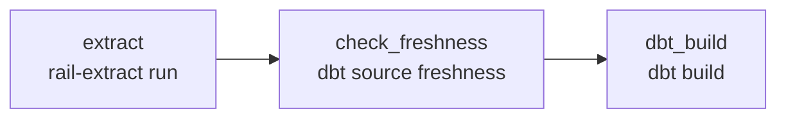
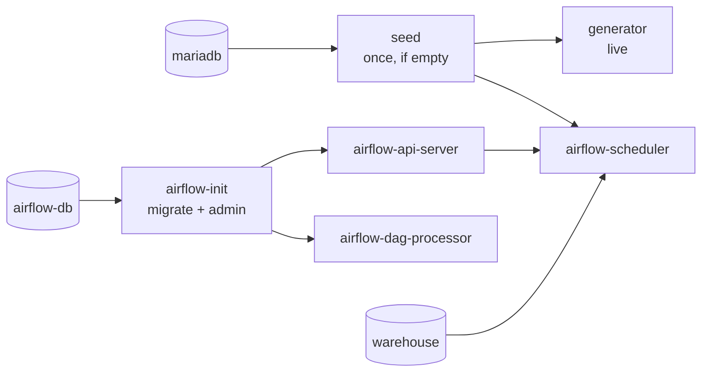
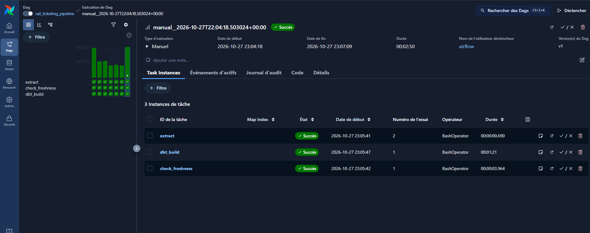
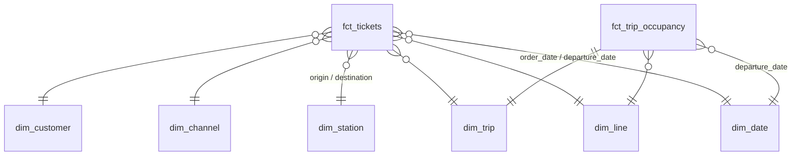
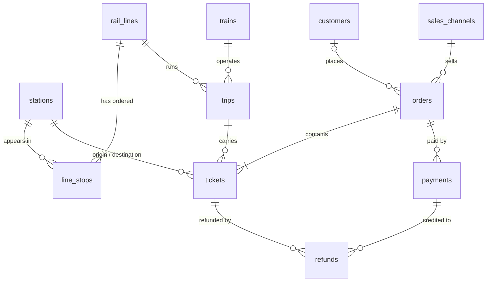

# Rail Ticketing Data Platform

[](https://github.com/bugtronik/rail-ticketing-data-platform/actions/workflows/ci.yml)

End-to-end ELT pipeline for a **fictional** rail operator's ticket sales:
a production-like MariaDB database feeds a PostgreSQL warehouse, modelled with
dbt and orchestrated by Airflow, so that a sales team can track revenue,
load factor, cancellations and sales channels **without querying production**.

All data is synthetic, produced by the project's own generator.

**📚 [dbt documentation and lineage](https://bugtronik.github.io/rail-ticketing-data-platform/)**:
every model, column and test, rebuilt by the CI on each push to `main`.

> 🚧 **Work in progress** — current milestone: **J6, end-to-end CI and published dbt docs**.

## Architecture

```mermaid
flowchart LR
    gen[Data generator<br/>live, every 30 s] -->|writes| src[(MariaDB<br/>OLTP source)]
    src -->|read-only batches| ext[Incremental extractor<br/>watermark on updated_at]
    ext -->|idempotent upsert| raw
    subgraph wh [PostgreSQL warehouse]
        raw[raw] -->|dbt| stg[staging] -->|dbt| int[intermediate] -->|dbt| marts[marts]
    end
    marts --> pbi[Power BI<br/>dashboard]
    af{{Airflow<br/>every hour}} -.1. extract.-> ext
    af -.2. dbt build.-> stg
```

## Stack

| Tool | Why it is here |
|---|---|
| MariaDB | Simulates the production OLTP database |
| PostgreSQL | Analytical warehouse, layered `raw` → `staging` → `intermediate` → `marts` |
| Python | Data generator and incremental extractor |
| dbt Core | SQL transformations, dimensional model, data tests, docs |
| Airflow | Scheduling, retries, idempotent re-runs |
| Docker Compose | One-command reproducible environment |
| GitHub Actions | Lint, tests, the whole platform run end to end, dbt docs published on Pages |
| Power BI | Business dashboard on the `marts` layer |

## Roadmap

- [x] **J0** — Repository foundations, tooling, CI lint
- [x] **J1** — MariaDB source schema
- [x] **J2** — Synthetic data generator
- [x] **J3** — Incremental extraction to PostgreSQL
- [x] **J4** — dbt dimensional model and tests
- [x] **J5** — Airflow orchestration, full `docker compose up` (MVP)
- [x] **J6** — End-to-end CI, published dbt docs
- [ ] **J7** — Incremental dbt models, customer history (SCD2)
- [ ] **J8** — Power BI dashboard
- [ ] **J9** — Benchmarks, final documentation

## Design decisions

Each significant choice is recorded as an Architecture Decision Record:

- [ADR 0001 — Batch incremental ingestion first, CDC later](docs/adr/0001-batch-incremental-ingestion.md)
- [ADR 0002 — Python tooling: uv, Ruff, SQLFluff, pre-commit](docs/adr/0002-python-tooling.md)
- [ADR 0003 — Source schema designed for incremental extraction](docs/adr/0003-source-schema-design.md)
- [ADR 0004 — Synthetic data generator: history and live modes](docs/adr/0004-synthetic-data-generator.md)
- [ADR 0005 — Incremental extraction: keyset batches, transactional watermark](docs/adr/0005-incremental-extraction-design.md)
- [ADR 0006 — dbt layers and a star schema with two fact tables](docs/adr/0006-dbt-dimensional-model.md)
- [ADR 0007 — Orchestration: Airflow 3 calls the project's command-line tools](docs/adr/0007-airflow-orchestration.md)

## Getting started

Requirements: Docker (Desktop with WSL2 on Windows), [uv](https://docs.astral.sh/uv/),
`make`. The running platform uses about 2.4 GB of memory (measured with
`docker stats`: Airflow ~1.5 GB, the three databases ~0.9 GB).

```bash
cp .env.example .env   # then change the passwords and secrets
make up                # build the image, start everything, wait until healthy
```

The first `make up` builds the image and seeds 90 days of history (a few
minutes); the next ones start in under a minute. Then:

- **Airflow** on <http://127.0.0.1:8080> (or the `AIRFLOW_PORT` set in `.env`,
     if 8080 is already taken on your machine; user `admin`, password
  `AIRFLOW_ADMIN_PASSWORD` from `.env`): the `rail_ticketing_pipeline` DAG
  starts on its own and runs every hour; `make run` triggers it now.
- **The warehouse** on `localhost:5432` (`marts` schema), for SQL clients
  and Power BI.
- `make logs` follows the generator and the scheduler; `make ps` shows the
  state of every service.

`make history` deletes everything and restarts with 2 years of history.
`make reset` deletes the data volumes, so the databases are rebuilt from
their `init/` scripts on the next `make up`; `make reset-warehouse` does it
for the warehouse only. Other commands: `make help`.

For development, the tools also run from the laptop against the same
databases (they publish their ports on localhost):

```bash
make install           # virtualenv from uv.lock + git hooks
make test              # unit + integration tests
make extract           # what the DAG's first task does
make transform         # what its last task does (dbt build)
make docs              # dbt documentation and lineage on http://localhost:8081
```

## Orchestration (Airflow)



One DAG, every hour; each task is a command of the project
([`airflow/dags/`](airflow/dags/rail_ticketing_pipeline.py)). Airflow only
schedules, retries and logs. Every task is idempotent: extraction resumes
from its watermark, dbt rebuilds from `raw`, so a retry or a manual re-run
can never duplicate or lose data. `extract` retries 3 times with exponential
backoff: tested by stopping MariaDB during a run (attempt 1 fails, attempt 2
succeeds once the database is back). Details: [ADR 0007](docs/adr/0007-airflow-orchestration.md).

`docker compose up` starts the services in dependency order:



A manual run in the Airflow UI: `extract` succeeded at its second attempt
(MariaDB had been stopped during the first one), then the rest of the run
went through without any intervention.



## Continuous integration

Every push runs three jobs ([`.github/workflows/ci.yml`](.github/workflows/ci.yml)):

| Job | What it proves |
|---|---|
| Lint | Ruff (Python), SQLFluff (SQL and dbt models), YAML/TOML hygiene: same hooks as `git commit` |
| Tests | unit and integration tests against real MariaDB and PostgreSQL containers |
| End-to-end pipeline | `docker compose up` on a clean runner with a month of data; the first DAG run must succeed on its own (extraction, freshness, `dbt build` with all its tests), and the marts must be filled |

On `main`, the end-to-end job also generates the dbt documentation from
the warehouse it has just built, and a fourth job publishes it on GitHub
Pages. Actions are pinned to commit SHAs and the workflow only gets
`contents: read`; the publishing job alone may write to Pages.

## Synthetic data

The generator (`src/rail_ticketing/generator/`) simulates a **fictional**
long-distance corridor: 19 stations over ~650 km, express, stopping and night
trains, prices in XAF. Every business assumption lives in
[`config/generator.toml`](config/generator.toml); one seed makes the whole
dataset reproducible.

What the data contains, by design: yearly seasonality (school holidays,
year-end), busy Fridays and Sundays, morning and evening rushes at the
counters, a two-year shift from counters to web and mobile, trains that sell
out at peak times (capacity checked segment by segment), payment failures,
cancellations that are not always refunded, cancelled trips, delay claims.

Measured on a full run (2 years of history):

| | |
|---|---|
| Rows written | 6.0 million (2.5 M tickets, 1.6 M orders, 1.7 M payments) |
| Duration | ~8 min (≈12,000 rows/s, batched inserts) |
| Memory peak | 86 MB (streamed day by day) |
| Average load factor | 47-56 % depending on the line (≈40 % in February, >70 % in August) |
| Live mode | one tick every 30 s, ~0.05 s of database work per tick |

## Incremental extraction

`rail-extract` (`src/rail_ticketing/extract/`) copies the 11 source tables
into the PostgreSQL `raw` schema without touching production more than
needed:

- reads only the rows changed since the last run (watermark on
  `updated_at`, plus a 10-minute overlap for late commits);
- in batches of 10,000 rows, each an index range scan (keyset pagination,
  no `OFFSET`), with a pause between batches and an optional time window;
- loads each batch with `COPY` and an idempotent upsert, and commits the
  rows **and** the new watermark in one transaction: a crash never loses or
  duplicates anything, a run can always be repeated.

| Measured (2 years of history, WSL2 laptop, 16 GB RAM) | |
|---|---|
| Initial load | 6.03 M rows in 167 s (~36,000 rows/s) |
| Time spent querying the source | ~74 s of the 167 s, ~0.1 s per 10,000-row batch |
| Incremental run after 2 min of live activity | 845 rows in 0.3 s |
| Check | counts, amount sums and latest `updated_at` identical on all tables |

Its guarantees are integration tests: run twice → no change; crash after
two batches, or Ctrl+C in the middle of one → resume without loss or
duplicate; outside the time window →
no query reaches the source; a commit later than the overlap → missed (a
documented limit of watermarks, which CDC would remove).

## Transformation (dbt)

dbt (`transform/`) turns `raw` into a star schema in three layers:
`staging` (renaming, UTC → local time, personal data dropped), `intermediate`
(each business rule written once), `marts` (the tables Power BI reads).



Two fact tables because there are two grains: `fct_tickets` (one row per
ticket: revenue, cancellations, refunds, channels) and `fct_trip_occupancy`
(one row per trip: seat-km offered against passenger-km sold, empty trips
included). The rules behind each number are in
[ADR 0006](docs/adr/0006-dbt-dimensional-model.md); the most important:

- a ticket is a sale only if its order was paid (`CONFIRMED`);
- revenue is reported by **date of sale**; refunds stay attached to the sale;
- load factor = Σ passenger-km / Σ seat-km on departed trips (a ratio of
  sums, never an average of ratios).

`dbt build` runs 133 models and tests: keys, accepted values, relationships,
a unit test on the "paid" rule, and business invariants (sales reconcile to
the franc with `raw`, refunds never exceed the price, load factor in
[0, 1]). The key ones were checked by breaking the code on purpose.

What the marts answer, on the 2 years of generated data (2.5 M tickets,
WSL2 laptop, 16 GB RAM):

| Question | Answer |
|---|---|
| Revenue | 30.4 bn XAF sold, 28.9 bn net of refunds; July-August sell 1.3-1.4× an average month, February 0.7× |
| Load factor (departed trips) | stopping trains lowest every month, express and night trains close together; 36-45 % in February, 63-76 % in August |
| Cancellations | 6.1 % of paid tickets: FLEX 10.4 %, STANDARD 5.5 %, SAVER 2.7 % |
| Refunds | 4.7 % of sales amount |
| Sales channels | station counters 48 %, partner agencies 17 %, online (web + app) 35 % |
| Peak hours | purchases peak at 8 am and 5 pm; travel is concentrated on the 6-7 am and 8 pm departures |

| Measured | |
|---|---|
| `dbt build` on 2 years (6.0 M raw rows) | 54 s for 22 models, 110 data tests and 1 unit test; `fct_tickets` (2.5 M rows) built in 25 s |

The SQL behind each answer is in [`transform/analyses/`](transform/analyses/).

## Source data model

Simulated production database (MariaDB, normalised). Every table also has
`created_at` / `updated_at`, maintained by the database.



## License

[MIT](LICENSE)
