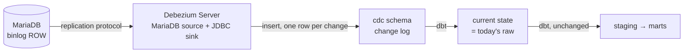

# ADR 0010 — Change data capture: the design of the next step

- **Status:** Proposed (designed, not built)
- **Date:** 2026-11-03

## Context

ADR 0001 chose batch extraction on an `updated_at` watermark and left change
data capture (CDC) for later. The project now shows, with its own incidents,
where the watermark reaches its limits:

| Limit | Seen in this project |
|---|---|
| A transaction committed more than 10 minutes after its `updated_at` is never read | an integration test proves it (ADR 0005) |
| A physical `DELETE` leaves no trace | the source schema had to forbid them (soft deletes only) |
| The tables are read one after the other, not as one consistent picture | 15 orphan tickets in J7, fixed by reading children before parents: a fix that depends on the order of 11 tables |
| Only the last version of a row between two runs reaches the warehouse | an order created, paid and cancelled within the hour arrives as cancelled only; the customer history (SCD2) is as precise as the hourly snapshot, not more |
| Freshness is bounded by the schedule | at worst one hour plus a pipeline run |
| Each run queries production | small and bounded (keyset batches, a time window), but never zero |

None of this hurts the current need (hourly sales reporting). It becomes a
problem if the business asks for near-real-time figures, for every status
change of an order, or if the source starts deleting rows.

## Decision (design)

Read the **MariaDB binary log** instead of querying the tables, with
**Debezium**, and land every change in PostgreSQL.

**Source.** Binary log in row format with full row images
(`binlog_format = ROW`, `binlog_row_image = FULL`), GTIDs on, and a
retention long enough to cover an outage of the pipeline (for example 7
days). A dedicated account with `SELECT, RELOAD, SHOW DATABASES,
REPLICATION SLAVE, REPLICATION CLIENT`: it reads the log the way a replica
does, and never queries the tables again after the initial snapshot.

**Capture.** **Debezium Server**, one container, without Kafka: its MariaDB
source connector reads the binlog and its JDBC sink writes to PostgreSQL.
Kafka (or Redpanda) is only worth its memory when several consumers need
the same changes; here there is one. Without a broker, the buffer is the
binlog itself: if the warehouse is down, Debezium stops reading and resumes
from its saved position.

**Landing: a change log, not a mirror.** One `cdc` table per source table,
append-only: the row after the change, the operation (`c`, `u`, `d`), the
commit time at the source, and the binlog position. A dbt model rebuilds the
current state (the last change of each key; a `d` removes the key), with the
same columns as today's `raw`. Staging and marts do not change. Keeping
every change, instead of upserting a mirror, is what removes the "last
version only" limit: the order's three statuses are all there, and the
customer history becomes exact instead of hourly.

**Correctness.**

- *Ordering and duplicates.* Delivery is at-least-once: after a crash,
  Debezium replays from its last saved position. The change log is keyed on
  (primary key, binlog position), so a replayed change is a duplicate key,
  ignored; "last change" means "highest position", never "latest arrival".
- *Transactions.* Debezium can attach the transaction id to each change.
  The current-state model only exposes complete transactions: an order and
  its tickets appear together, whatever the table order. This replaces the
  children-first rule of ADR 0005.
- *Deletes* become ordinary `d` rows, tested like the rest.
- *Schema changes.* Debezium records the source schema history. Rule:
  additive changes only at the source (expand, then contract later); the
  sink can add columns, a rename or a drop needs a migration on both sides.

**Initial load.** An initial snapshot, then streaming from the binlog
position it ends at. On a busy production database, an *incremental
snapshot* (in chunks, through a signalling table) avoids holding a
consistent snapshot open for minutes, the same concern as ADR 0005's short
transactions.

**Orchestration.** Airflow no longer extracts. `dbt build` keeps its
schedule (or runs every 15 minutes if the business needs it); the freshness
test moves from `raw._extracted_at` to the commit time of the last change.
Two new alerts: Debezium's lag behind the source, and the binlog retention
(if Debezium stays down longer than the retention, changes are lost and a
new snapshot is required).

**Migration.** Run CDC next to the current extractor for a few days, compare
per table the counts, the amount sums and the latest `updated_at` (the
checks of J3), then point dbt's `raw` sources to the CDC current-state
models. Keep the extractor one release as a fallback.

**To validate in a spike before building.** The exact Debezium properties
for this pair (MariaDB source, PostgreSQL JDBC sink) and the transaction
metadata in Debezium Server; the memory of the extra container on the
laptop; the end-to-end delay under the live generator.

## Why it is not built

The current need is hourly; the watermark meets it, and its limits are
known, tested and documented. CDC adds a JVM service, a binlog to configure
and size, and a new failure mode (retention exceeded). Built now, it would
cost more memory on a 16 GB laptop and more operations than it brings to an
hourly sales report.

## Consequences

- **+** Freshness in seconds instead of an hour; deletes, late commits and
  intermediate statuses are all captured; no query on the source tables
  after the snapshot.
- **+** Cross-table consistency comes from transactions, not from the order
  in which tables are read.
- **+** Exact customer history, from the actual changes.
- **−** One more service to run and watch (lag, retention), and a binlog to
  enable and size on production: a change the database administrators must
  accept.
- **−** The change log grows with every change: it needs a retention or a
  compaction policy.
- **−** At-least-once delivery means the deduplication rule is part of the
  design and must be tested, like the watermark's guarantees are today.
