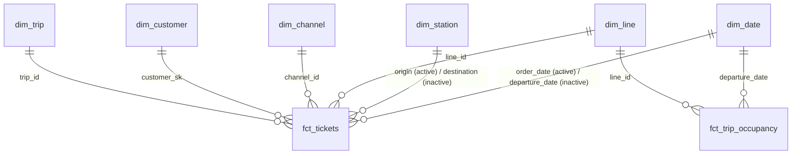

# Power BI report

The report reads the `marts` schema of the warehouse (`transform/models/marts/`)
with the `bi_reader` account, which can read the marts and nothing else.
It is saved as a **Power BI project** (PBIP): the report and the semantic
model are plain text files (JSON / TMDL), so every change shows up in a
Git diff like code.

## Connection

- **Import** mode: Power BI loads the marts into its own engine at each
  refresh (~340,000 tickets with the default 90 days of history). DirectQuery would send
  every visual's query to PostgreSQL, which is slower to use and adds load
  on the warehouse, for data that only changes once an hour.
- Two Power Query **parameters**, `WarehouseServer` (e.g. `localhost:5432`)
  and `WarehouseDatabase` (`warehouse`), so the report points to another
  warehouse by changing a value, not by editing queries.
- Credentials are **not** in the project files: Power BI Desktop keeps them
  in the Windows user profile. The local cache (`.pbi/cache.abf`) and
  settings (`.pbi/localSettings.json`) are git-ignored.

## Model



The same 10 relationships, with the column on each side. A dimension keeps
its own name for the key: `date_day` in `dim_date`, `station_id` in
`dim_station`. The fact table says which role it plays (`order_date`,
`origin_station_id`).

| Fact table (many) | Column | Dimension (one) | Column | Active |
|---|---|---|---|---|
| `fct_tickets` | `order_date` | `dim_date` | `date_day` | yes |
| `fct_tickets` | `departure_date` | `dim_date` | `date_day` | **no** |
| `fct_tickets` | `origin_station_id` | `dim_station` | `station_id` | yes |
| `fct_tickets` | `destination_station_id` | `dim_station` | `station_id` | **no** |
| `fct_tickets` | `line_id` | `dim_line` | `line_id` | yes |
| `fct_tickets` | `channel_id` | `dim_channel` | `channel_id` | yes |
| `fct_tickets` | `customer_sk` | `dim_customer` | `customer_sk` | yes |
| `fct_tickets` | `trip_id` | `dim_trip` | `trip_id` | yes |
| `fct_trip_occupancy` | `departure_date` | `dim_date` | `date_day` | yes |
| `fct_trip_occupancy` | `line_id` | `dim_line` | `line_id` | yes |

- All relationships are **one-to-many, single direction** (dimension
  filters fact). No bidirectional filter: they make results depend on
  the path Power BI picks.
- `dim_date` and `dim_station` play two roles in `fct_tickets`. One
  relationship is active (date of **sale**: the main view of revenue;
  origin station), the other one inactive, used by a measure with
  `USERELATIONSHIP`.
- `fct_trip_occupancy` is not related to `dim_trip`: it already carries the
  trip's line, date, hour and status, and a one-to-one relationship would
  default to bidirectional filtering.
- `dim_customer` is joined on `customer_sk`, the customer's **version** at
  the time of the order (SCD type 2, ADR 0008), not on `customer_id`.
- `dim_date` is marked as the date table (`date_day`); `month_name` is
  sorted by `month_number`, `day_name` by `day_of_week`.

## Measures

Additive amounts and counts are columns of the marts. Ratios are DAX
measures: a ratio must be computed **after** aggregation, in the filter
context of each visual (the load factor of a month is not the average of
its trips' load factors).

```dax
Billets vendus = CALCULATE ( COUNTROWS ( fct_tickets ), fct_tickets[is_paid] = TRUE () )
Billets annulés = CALCULATE ( COUNTROWS ( fct_tickets ), fct_tickets[is_cancelled] = TRUE () )
CA brut = SUM ( fct_tickets[sales_amount] )
Remboursements = SUM ( fct_tickets[refunded_amount] )
CA net = SUM ( fct_tickets[net_sales_amount] )
Prix moyen du billet = DIVIDE ( [CA brut], [Billets vendus] )
Taux d'annulation = DIVIDE ( [Billets annulés], [Billets vendus] )
Taux de remboursement = DIVIDE ( [Remboursements], [CA brut] )
Part du CA en ligne =
    DIVIDE ( CALCULATE ( [CA brut], KEEPFILTERS ( dim_channel[is_online] = TRUE () ) ), [CA brut] )
CA par date de voyage =
    CALCULATE ( [CA brut], USERELATIONSHIP ( fct_tickets[departure_date], dim_date[date_day] ) )
Passagers-km =
    CALCULATE ( SUM ( fct_trip_occupancy[passenger_km] ), fct_trip_occupancy[trip_status] = "COMPLETED" )
Sièges-km =
    CALCULATE ( SUM ( fct_trip_occupancy[seat_km] ), fct_trip_occupancy[trip_status] = "COMPLETED" )
Taux de remplissage = DIVIDE ( [Passagers-km], [Sièges-km] )
```

The load factor only counts departed trips: a scheduled trip is still
selling, its load factor is not final.

## Report

Three pages for business readers, plus a hidden **Contrôles** page with one
card per documented measure (the check against SQL, below).

| Page | KPI tiles | Visuals |
|---|---|---|
| Synthèse des ventes | CA net, billets vendus, prix moyen, taux d'annulation, part du CA en ligne, taux de remplissage | daily net revenue with a 7-day moving average; rankings by line, passenger type and fare type |
| Exploitation et remplissage | taux de remplissage, trajets réalisés, trajets annulés, voyageurs par train, passagers-km | daily load factor; load factor by line; heat map line × departure hour |
| Canaux et achats | part du CA en ligne, CA en ligne, billets par commande, anticipation | online share trend; revenue by channel; heat map day × purchase hour |

**KPI tiles show the last 30 complete days, compared with the 30 days
before.** The data is loaded every hour, so the current day and the current
month are always incomplete: a "this month" figure would always look like a
drop. `Dernier jour complet` is the day before the last sale; each KPI has
three companion measures, generated from the same pattern:

| Measure | Role |
|---|---|
| `<KPI> 30 j` | the KPI over the 30 complete days (`DATESBETWEEN` on `dim_date`) |
| `<KPI> 30 j préc.` | the same KPI over the 30 days before |
| `Évol. <KPI> 30 j` | relative change for amounts and counts; change in **points** for rates |
| `(texte)`, `(couleur)` | hidden: the "▲ 4,2 % vs 30 j préc." label and its colour |

The colour follows the business meaning, not the sign: more cancellations
is red, fewer is green; the purchase lead time has no good direction and
stays neutral.

**Daily trends show the last 60 complete days.** The synthetic history
starts with a ramp: the first trips are sold over several weeks before
they depart, so the first weeks of sales are not representative. Sixty days
skip it, and stay readable day by day.

Display folders: `1. Ventes`, `2. Exploitation` (the documented measures
and a few more), `2. Indicateurs 30 j`, `3. Évolutions 30 j`,
`4. Contexte` (freshness and period labels), `5. Tendances` (daily series
and 7-day moving averages), `9. Mise en forme` (hidden).

**Display labels.** Three calculated columns translate codes for the
reader: `fct_tickets[Type de voyageur]`, `fct_tickets[Type de tarif]` and
`fct_trip_occupancy[Sens]`. They are presentation only: if another tool
reads the marts one day, these labels belong in dbt.

**Theme.** `StaticResources/RegisteredResources/RailTicketingTheme.json`:
deep violet, an orange accent and Arial, inspired by a corporate template,
without any logo. Each page says that the data is synthetic and the network
fictional.

## Checking the numbers

[`transform/analyses/dashboard_checks.sql`](../transform/analyses/dashboard_checks.sql)
computes the expected value of each measure in SQL, over all the data.
With no filter, every card of the report must show the same number. If a
card disagrees, the measure or a relationship is wrong.

```bash
uv run --env-file .env dbt compile --select dashboard_checks --project-dir transform --profiles-dir transform
docker compose exec -T warehouse psql -U warehouse_admin -d warehouse \
  < transform/target/compiled/rail_ticketing/analyses/dashboard_checks.sql
```
