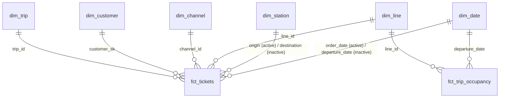

# Power BI report

The report reads the `marts` schema of the warehouse (`transform/models/marts/`)
with the `bi_reader` account, which can read the marts and nothing else.
It is saved as a **Power BI project** (PBIP): the report and the semantic
model are plain text files (JSON / TMDL), so every change shows up in a
Git diff like code.

## Connection

- **Import** mode: Power BI loads the marts into its own engine at each
  refresh (~2.6 M rows in the fact tables). DirectQuery would send
  every visual's query to PostgreSQL, which is slower to use and adds load
  on the warehouse, for data that only changes once an hour.
- Two Power Query **parameters**, `WarehouseServer` (e.g. `localhost:5432`)
  and `WarehouseDatabase` (`warehouse`), so the report points to another
  warehouse by changing a value, not by editing queries.
- Credentials are **not** in the project files: Power BI Desktop keeps them
  in the Windows user profile. The local cache (`.pbi/cache.abf`) and
  settings (`.pbi/localSettings.json`) are git-ignored.

## Model



- All relationships are **one-to-many, single direction** (dimension
  filters fact). No bidirectional filter: they make results depend on
  the path Power BI picks.
- `dim_date` and `dim_station` play two roles in `fct_tickets`. One
  relationship is active (date of **sale**: the main view of revenue;
  origin station), the other one inactive, used by a measure with
  `USERELATIONSHIP`.
- `fct_trip_occupancy` is not related to `dim_trip`: it already carries the
  trip's line, date, hour and status, and a one-to-one relationship would
  default to bidirectional filtering.
- `dim_customer` is joined on `customer_sk`, the customer's **version** at
  the time of the order (SCD type 2, ADR 0008), not on `customer_id`.
- `dim_date` is marked as the date table (`date_day`); `month_name` is
  sorted by `month_number`, `day_name` by `day_of_week`.

## Measures

Additive amounts and counts are columns of the marts. Ratios are DAX
measures: a ratio must be computed **after** aggregation, in the filter
context of each visual (the load factor of a month is not the average of
its trips' load factors).

```dax
Billets vendus = CALCULATE ( COUNTROWS ( fct_tickets ), fct_tickets[is_paid] = TRUE () )
Billets annulés = CALCULATE ( COUNTROWS ( fct_tickets ), fct_tickets[is_cancelled] = TRUE () )
CA brut = SUM ( fct_tickets[sales_amount] )
Remboursements = SUM ( fct_tickets[refunded_amount] )
CA net = SUM ( fct_tickets[net_sales_amount] )
Prix moyen du billet = DIVIDE ( [CA brut], [Billets vendus] )
Taux d'annulation = DIVIDE ( [Billets annulés], [Billets vendus] )
Taux de remboursement = DIVIDE ( [Remboursements], [CA brut] )
Part du CA en ligne =
    DIVIDE ( CALCULATE ( [CA brut], KEEPFILTERS ( dim_channel[is_online] = TRUE () ) ), [CA brut] )
CA par date de voyage =
    CALCULATE ( [CA brut], USERELATIONSHIP ( fct_tickets[departure_date], dim_date[date_day] ) )
Passagers-km =
    CALCULATE ( SUM ( fct_trip_occupancy[passenger_km] ), fct_trip_occupancy[trip_status] = "COMPLETED" )
Sièges-km =
    CALCULATE ( SUM ( fct_trip_occupancy[seat_km] ), fct_trip_occupancy[trip_status] = "COMPLETED" )
Taux de remplissage = DIVIDE ( [Passagers-km], [Sièges-km] )
```

The load factor only counts departed trips: a scheduled trip is still
selling, its load factor is not final.

## Checking the numbers

[`transform/analyses/dashboard_checks.sql`](../transform/analyses/dashboard_checks.sql)
computes the expected value of each measure in SQL, over all the data.
With no filter, every card of the report must show the same number. If a
card disagrees, the measure or a relationship is wrong.

```bash
uv run --env-file .env dbt compile --select dashboard_checks --project-dir transform --profiles-dir transform
docker compose exec -T warehouse psql -U warehouse_admin -d warehouse \
  < transform/target/compiled/rail_ticketing/analyses/dashboard_checks.sql
```
